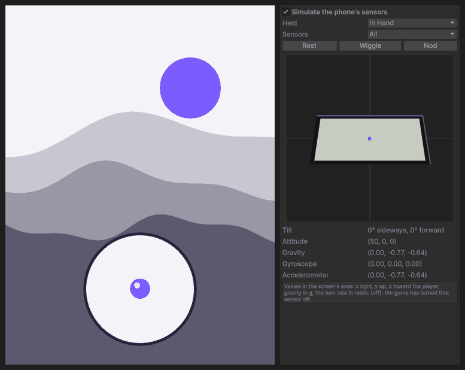
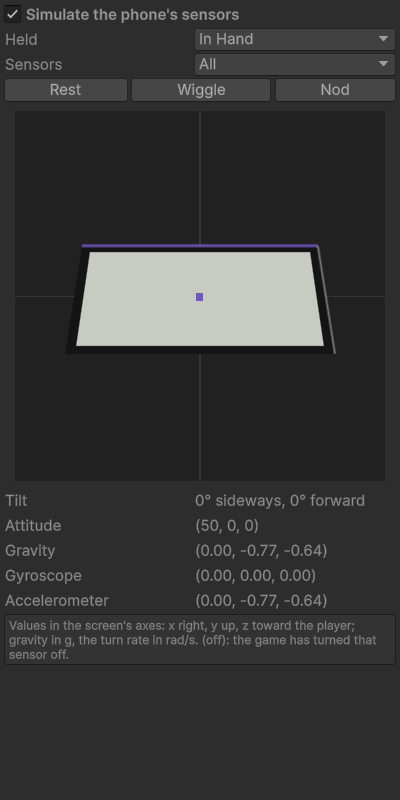
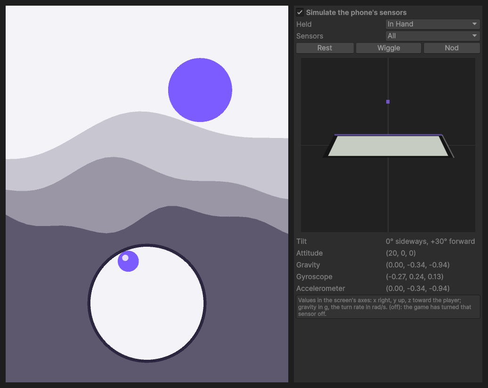
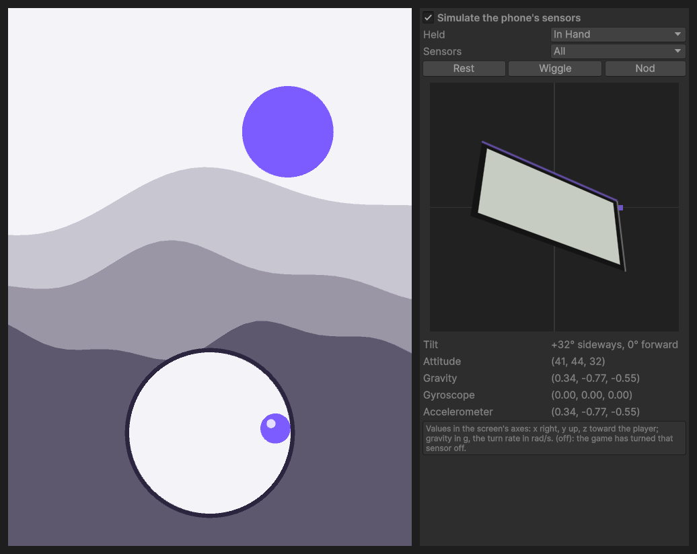

# Tilt Simulator

[English](README.md) · **Español**

Un teléfono virtual para el editor de Unity. Lo inclinas desde una ventana y los sensores de movimiento del Input System
(orientación, gravedad, giroscopio y acelerómetro) leen ese teléfono como si fuera real. Así pruebas en Play mode los
controles por inclinación, el paralaje y cualquier efecto que dependa del movimiento, sin compilar ni pasar nada a un
teléfono.



- **Sensores de verdad, no un atajo:** agrega dispositivos virtuales `AttitudeSensor`, `GravitySensor`, `Gyroscope` y
  `Accelerometer`. Tu juego los lee con `AttitudeSensor.current`, `GravitySensor.current` y compañía, igual que en el
  teléfono. No hay que tocar su código ni agregar ramas `#if UNITY_EDITOR`.
- **Se maneja con el mouse o el teclado:** arrastra sobre el recuadro o usa las flechas. *Rest* lo endereza, *Wiggle*
  lo mece de lado a lado y *Nod* lo cabecea.
- **Tres formas de sostenerlo:** en la mano (inclinado 40°, como al jugar), parado frente a ti o acostado en la mesa.
- **Sensores a elección:** quita uno para probar qué hace tu juego en un teléfono que no lo tiene, como los que traen
  acelerómetro pero no giroscopio.
- **Respeta la orientación de la pantalla:** manda los valores en los ejes propios del dispositivo, como un teléfono, y
  se ve bien en vertical y en horizontal, también al girar la pantalla con el Device Simulator.
- **Se controla desde código:** sirve para tests automáticos y para grabar demos.
- **Solo en el editor:** nada del paquete llega a una build.

## Cuándo sirve

- **Paralaje y fondos que se mueven con el teléfono:** fondos por capas, tarjetas con brillo holográfico, menús que se
  inclinan.
- **Controles por inclinación:** laberintos con canica, juegos de carreras que se manejan girando el teléfono,
  equilibrio, apuntar moviendo el teléfono.
- **Efectos visuales que dependen del ángulo:** sombras, reflejos o luces que cambian según cómo se sostiene la
  pantalla.
- **Probar los casos difíciles:** el teléfono sin giroscopio, el juego en horizontal, el sensor que el juego apaga para
  ahorrar batería, la vuelta a la posición de reposo.
- **Iterar rápido:** ajustar sensibilidades, zonas muertas y filtros en Play mode sin esperar una build.
- **Tests y grabaciones:** fijar una inclinación exacta desde un test o grabar una demo con movimientos que se repiten
  siempre iguales.

No reemplaza probar en un teléfono real. El simulador no tiene el ruido ni la deriva de un sensor real, no simula
sacudidas (aceleración lineal) y no sirve para el Input Manager antiguo (`UnityEngine.Input.gyro`,
`Input.acceleration`). Solo funciona con el Input System.

## Instalación

**Window → Package Manager → + → Add package from git URL…** con:

```
https://github.com/ModernWestern/unity.modernwestern.tilt-simulator-package.git
```

O en `Packages/manifest.json`, fijando una versión:

```json
"com.modernwestern.tilt-simulator": "https://github.com/ModernWestern/unity.modernwestern.tilt-simulator-package.git#v1.0.0"
```

**Requisitos:** Unity 2022.3 o más nuevo, Input System 1.7.0 o más nuevo, y en **Project Settings → Player → Active
Input Handling**, *Input System Package (New)* o *Both*.

## Cómo usarlo

1. Abre **Window → Analysis → Tilt Simulator**. La primera vez en cada sesión del editor, la ventana enciende el
   teléfono virtual.
2. Dale **Play**.
3. Arrastra sobre el recuadro:
   - **A la derecha**, el lado derecho del teléfono se aleja de ti. A la izquierda, se aleja el izquierdo.
   - **Hacia arriba**, el borde de arriba se aleja de ti. Hacia abajo, se acerca.
   - El punto morado marca la inclinación, hasta 60° por eje. El dibujo muestra el teléfono en perspectiva tal como lo
     verías en la mano: su borde de arriba va en morado y el derecho en blanco.
4. Con la ventana enfocada, las **flechas** lo mueven de 5° en 5°.



| Control | Qué hace |
|---|---|
| **Simulate the phone's sensors** | Agrega los sensores virtuales. Apagado, los quita. |
| **Held** | Cómo se sostiene antes de inclinarlo: *In Hand* (40° hacia atrás), *Upright* (parado) o *Flat* (en la mesa, boca arriba). |
| **Sensors** | Qué sensores tiene el teléfono. Quitar uno equivale a un teléfono sin ese sensor. |
| **Rest** / **Wiggle** / **Nod** | Lo endereza, lo mece de lado a lado una vez o lo cabecea una vez. |
| Lecturas | Lo que lee cada sensor ahora, en los ejes de la pantalla. *(off)* indica que el juego apagó ese sensor. |

Así se ve con el borde de arriba alejado 30°: la gravedad pasa casi toda al eje z y la canica del ejemplo rueda hacia
arriba.



## Leer los sensores en tu juego

Igual que en un teléfono, cada sensor se enciende antes de leerlo:

```csharp
using UnityEngine;
using UnityEngine.InputSystem;

public sealed class TiltReader : MonoBehaviour
{
    private void OnEnable()
    {
        if (GravitySensor.current != null)
        {
            InputSystem.EnableDevice(GravitySensor.current);
        }
    }

    private void OnDisable()
    {
        if (GravitySensor.current != null)
        {
            InputSystem.DisableDevice(GravitySensor.current);
        }
    }

    private void Update()
    {
        if (GravitySensor.current is not { enabled: true } sensor)
        {
            return;
        }

        // In g, in the device's own axes (with compensateForScreenOrientation on, in the screen's).
        var gravity = sensor.gravity.ReadValue();

        transform.localRotation = Quaternion.Euler(gravity.y * 20f, -gravity.x * 20f, 0f);
    }
}
```

Los sensores virtuales arrancan encendidos para que puedas activar el simulador en plena partida. En un teléfono
arrancan apagados, así que no te saltes el `EnableDevice`.

### Ejes y unidades

| Sensor | Valor | Unidad | En reposo, en la mano |
|---|---|---|---|
| `AttitudeSensor.attitude` | orientación del teléfono | cuaternión (identidad: acostado boca arriba) | 50° desde acostado |
| `GravitySensor.gravity` | gravedad | g (1 = 9,81 m/s²) | (0, -0,77, -0,64) |
| `Accelerometer.acceleration` | aceleración; quieto, es la gravedad | g | (0, -0,77, -0,64) |
| `Gyroscope.angularVelocity` | velocidad de giro | rad/s | (0, 0, 0) |

Los ejes son los de la pantalla en vertical: **x** hacia la derecha, **y** hacia arriba y **z** saliendo de la pantalla
hacia ti. Acostado boca arriba, la gravedad vale (0, 0, -1); parado frente a ti, (0, -1, 0).

**Orientación de la pantalla:** un teléfono manda sus valores en sus propios ejes, los de la pantalla en vertical,
aunque el juego esté en horizontal, y el simulador hace lo mismo. Para tener los ejes de la pantalla en cualquier
orientación, activa `InputSystem.settings.compensateForScreenOrientation` o gira los valores tú según
`Screen.orientation`. Con el Device Simulator abierto y la pantalla girada, el resultado es igual al de un teléfono.

## Desde código y tests

`TiltSimulator` controla el mismo teléfono que la ventana:

```csharp
using ModernWestern.TiltSimulator;
using UnityEngine;

TiltSimulator.Enabled = true;
TiltSimulator.Pose = HoldPose.InHand;
TiltSimulator.Sensors = SimulatedSensors.Gravity | SimulatedSensors.Accelerometer; // a phone without a gyroscope
TiltSimulator.Tilt = new Vector2(25f, 0f);   // the right side 25° away
TiltSimulator.Refresh();                     // send it now instead of on the next editor update
```

- `Tilt`: grados desde la pose. **x** gira sobre la vertical de la pantalla (positivo: el lado derecho se aleja) e
  **y** sobre su horizontal (positivo: el borde de arriba se aleja).
- `Attitude`, `Gravity` y `AngularVelocity`: lo que lee el teléfono ahora, en los ejes de la pantalla.
- `TiltMath`: la misma matemática sin estado, para tus propias pruebas.
- El estado dura hasta cerrar el editor: sobrevive a entrar en Play mode y a las recargas de scripts.

En un test con `InputTestFixture`, el simulador agrega sus sensores al Input System de prueba:

```csharp
[Test]
public void TippingRight_MovesTheMarbleRight()
{
    TiltSimulator.Enabled = true;
    TiltSimulator.Tilt = new Vector2(30f, 0f);
    TiltSimulator.Refresh();
    InputSystem.Update();

    Assert.Greater(GravitySensor.current.gravity.ReadValue().x, 0f);
}
```

## Ejemplo

En **Package Manager → Tilt Simulator → Samples**, importa **Tilt Demo** y abre la escena `Tilt Demo`. Tiene colinas
en capas que se desplazan con la inclinación (paralaje) y una canica que rueda en una bandeja. El código lee solo el
Input System, así que funciona igual en un teléfono.



## Cómo funciona

- Mientras está encendido, en cada actualización del editor (dentro y fuera de Play mode) calcula la orientación del
  teléfono a partir de la pose y la inclinación. De ahí saca la gravedad y la velocidad de giro, las pasa a los ejes
  del dispositivo y las manda como eventos de estado a los dispositivos virtuales. Cada uno queda como el `current` de
  su tipo.
- Los dispositivos se llaman `TiltSimulatorAttitude`, `TiltSimulatorGravity`, `TiltSimulatorGyroscope` y
  `TiltSimulatorAccelerometer`, y aparecen en **Window → Analysis → Input Debugger**. Al apagar el simulador se quitan.
- Contesta las consultas de frecuencia de muestreo (`Sensor.samplingFrequency`) como un sensor real. Sin esto, un
  dispositivo virtual lanzaría una excepción.
- Si el juego apaga un sensor con `DisableDevice`, el simulador deja de mandarle datos y ese sensor conserva su último
  valor, como en un teléfono.

## Licencia

[MIT](LICENSE).
