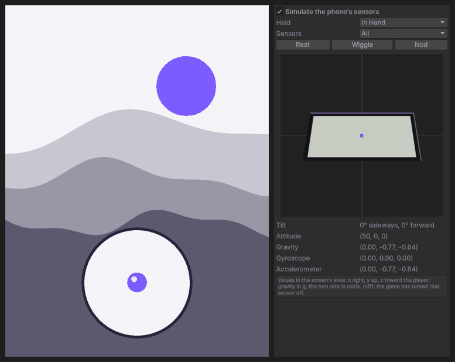
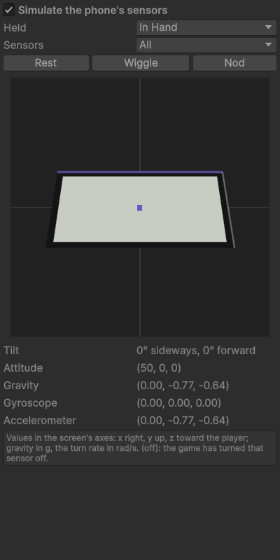
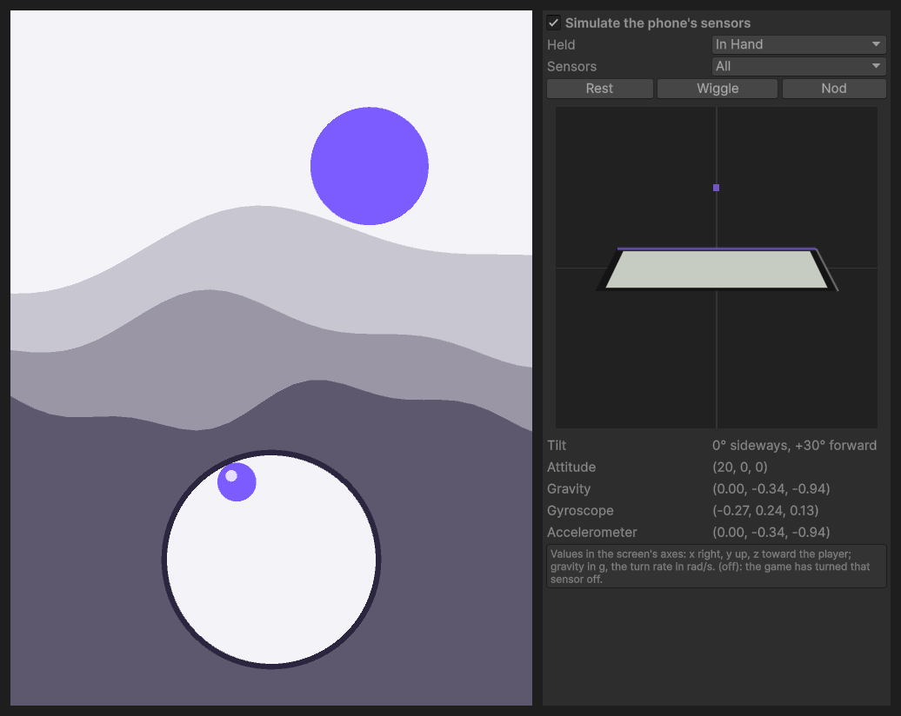
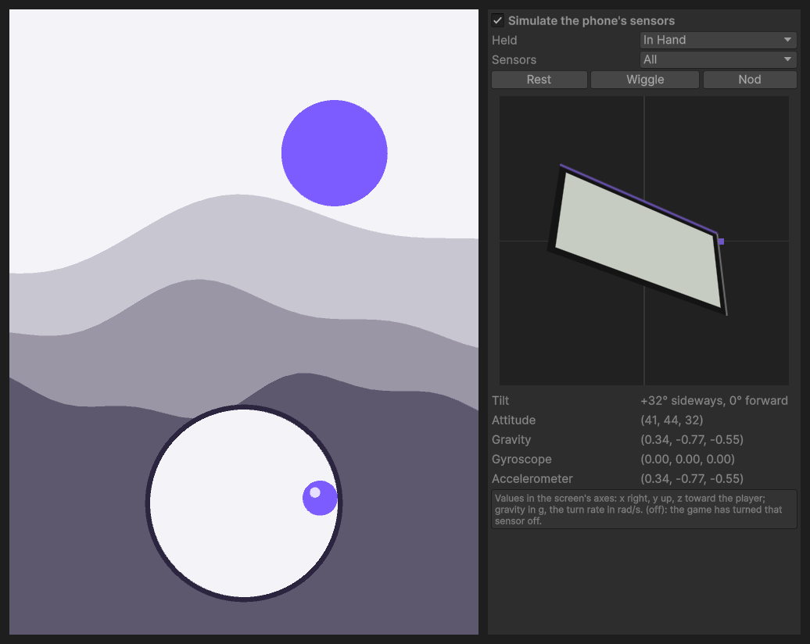

# Tilt Simulator

**English** · [Español](README.es.md)

A virtual phone for the Unity editor. You tilt it from a window, and the Input System's motion sensors (attitude,
gravity, gyroscope and accelerometer) read it as if it were a real one. Test tilt controls, parallax and any effect that
depends on motion in Play mode, without building or deploying to a phone.



- **Real sensors, not a shortcut:** it adds virtual `AttitudeSensor`, `GravitySensor`, `Gyroscope` and `Accelerometer`
  devices. Your game reads them with `AttitudeSensor.current`, `GravitySensor.current` and so on, just like on a phone.
  No changes to its code and no `#if UNITY_EDITOR` branches.
- **Mouse or keyboard:** drag on the pad or use the arrow keys. *Rest* straightens it, *Wiggle* rocks it side to side
  and *Nod* tips it back and forth.
- **Three ways to hold it:** in the hand (leaning back 40°, as when playing), upright in front of you, or lying flat on
  a table.
- **Pick the sensors:** leave one out to see what your game does on a phone without it, such as the ones with an
  accelerometer but no gyroscope.
- **Respects the screen's orientation:** it sends the values in the device's own axes, like a phone, so it works in
  portrait and landscape, and when you rotate the screen in the Device Simulator.
- **Scriptable:** drive it from code for automated tests and for recording demos.
- **Editor only:** nothing from the package ends up in a build.

## When it helps

- **Parallax and backgrounds that move with the phone:** layered backgrounds, cards with a holographic shine, menus that
  tilt.
- **Tilt controls:** marble mazes, racing games steered by turning the phone, balance games, aiming by moving the phone.
- **Visual effects that depend on the angle:** shadows, reflections or lights that change with how the screen is held.
- **Testing the hard cases:** a phone without a gyroscope, the game in landscape, a sensor the game turns off to save
  battery, the return to the rest position.
- **Fast iteration:** tune sensitivities, dead zones and filters in Play mode instead of waiting for a build.
- **Tests and recordings:** set an exact tilt from a test, or record a demo with moves that repeat exactly the same
  every time.

It does not replace testing on a real phone. The simulator has no real sensor noise or drift, does not simulate shakes
(linear acceleration), and does not work with the old Input Manager (`UnityEngine.Input.gyro`, `Input.acceleration`).
It only works with the Input System.

## Installation

**Window → Package Manager → + → Add package from git URL…** with:

```
https://github.com/ModernWestern/unity.modernwestern.tilt-simulator-package.git
```

Or in `Packages/manifest.json`, pinned to a version:

```json
"com.modernwestern.tilt-simulator": "https://github.com/ModernWestern/unity.modernwestern.tilt-simulator-package.git#v1.0.0"
```

**Requirements:** Unity 2022.3 or newer, Input System 1.7.0 or newer, and **Project Settings → Player → Active Input
Handling** set to *Input System Package (New)* or *Both*.

## How to use it

1. Open **Window → Analysis → Tilt Simulator**. The first time in each editor session, the window turns the virtual
   phone on.
2. Press **Play**.
3. Drag on the pad:
   - **To the right**, the phone's right side moves away from you. To the left, the left side does.
   - **Up**, the top edge moves away from you. Down, it comes closer.
   - The purple dot marks the tilt, up to 60° per axis. The drawing shows the phone in perspective as you would see it
     in your hand: its top edge in purple and its right edge in white.
4. With the window focused, the **arrow keys** move it in 5° steps.



| Control | What it does |
|---|---|
| **Simulate the phone's sensors** | Adds the virtual sensors. Off, it removes them. |
| **Held** | How the phone is held before tilting it: *In Hand* (leaning back 40°), *Upright* or *Flat* (on a table, face up). |
| **Sensors** | Which sensors the phone has. Leaving one out is a phone without that sensor. |
| **Rest** / **Wiggle** / **Nod** | Straightens it, rocks it side to side once, or tips it back and forth once. |
| Readings | What each sensor reads now, in the screen's axes. *(off)* means the game turned that sensor off. |

This is the top edge 30° away: gravity moves almost entirely to the z axis, and the sample's marble rolls up.



## Reading the sensors in your game

Just like on a phone, turn each sensor on before reading it:

```csharp
using UnityEngine;
using UnityEngine.InputSystem;

public sealed class TiltReader : MonoBehaviour
{
    private void OnEnable()
    {
        if (GravitySensor.current != null)
        {
            InputSystem.EnableDevice(GravitySensor.current);
        }
    }

    private void OnDisable()
    {
        if (GravitySensor.current != null)
        {
            InputSystem.DisableDevice(GravitySensor.current);
        }
    }

    private void Update()
    {
        if (GravitySensor.current is not { enabled: true } sensor)
        {
            return;
        }

        // In g, in the device's own axes (with compensateForScreenOrientation on, in the screen's).
        var gravity = sensor.gravity.ReadValue();

        transform.localRotation = Quaternion.Euler(gravity.y * 20f, -gravity.x * 20f, 0f);
    }
}
```

The virtual sensors start on, so you can turn the simulator on in the middle of a session. On a phone they start off,
so don't skip the `EnableDevice`.

### Axes and units

| Sensor | Value | Unit | At rest, in the hand |
|---|---|---|---|
| `AttitudeSensor.attitude` | the phone's orientation | quaternion (identity: lying flat, face up) | 50° from flat |
| `GravitySensor.gravity` | gravity | g (1 = 9.81 m/s²) | (0, -0.77, -0.64) |
| `Accelerometer.acceleration` | acceleration; held still, it is gravity | g | (0, -0.77, -0.64) |
| `Gyroscope.angularVelocity` | turn rate | rad/s | (0, 0, 0) |

The axes are the portrait screen's: **x** to the right, **y** up and **z** out of the screen toward you. Lying flat,
face up, gravity reads (0, 0, -1); upright in front of you, (0, -1, 0).

**Screen orientation:** a phone sends its values in its own axes, the portrait screen's, even when the game runs in
landscape, and the simulator does the same. To get the screen's axes in any orientation, turn on
`InputSystem.settings.compensateForScreenOrientation` or rotate the values yourself by `Screen.orientation`. With the
Device Simulator open and the screen rotated, you get the same result as on a phone.

## From code and tests

`TiltSimulator` drives the same phone as the window:

```csharp
using ModernWestern.TiltSimulator;
using UnityEngine;

TiltSimulator.Enabled = true;
TiltSimulator.Pose = HoldPose.InHand;
TiltSimulator.Sensors = SimulatedSensors.Gravity | SimulatedSensors.Accelerometer; // a phone without a gyroscope
TiltSimulator.Tilt = new Vector2(25f, 0f);   // the right side 25° away
TiltSimulator.Refresh();                     // send it now instead of on the next editor update
```

- `Tilt`: degrees from the pose. **x** turns about the screen's vertical (positive: the right side moves away) and **y**
  about its horizontal (positive: the top edge moves away).
- `Attitude`, `Gravity` and `AngularVelocity`: what the phone reads now, in the screen's axes.
- `TiltMath`: the same math without state, for your own checks.
- The state lasts until the editor closes: it survives entering Play mode and script reloads.

In a test with `InputTestFixture`, the simulator adds its sensors to the test's Input System:

```csharp
[Test]
public void TippingRight_MovesTheMarbleRight()
{
    TiltSimulator.Enabled = true;
    TiltSimulator.Tilt = new Vector2(30f, 0f);
    TiltSimulator.Refresh();
    InputSystem.Update();

    Assert.Greater(GravitySensor.current.gravity.ReadValue().x, 0f);
}
```

## Sample

In **Package Manager → Tilt Simulator → Samples**, import **Tilt Demo** and open the `Tilt Demo` scene. It has layered
hills that shift with the tilt (parallax) and a marble that rolls on a tray. Its code only reads the Input System, so it
works the same on a phone.



## How it works

- While it is on, on every editor update (in and out of Play mode) it works out the phone's orientation from the pose
  and the tilt. From that it gets gravity and the turn rate, converts them to the device's axes and sends them as state
  events to the virtual devices. Each one becomes the `current` device of its type.
- The devices are named `TiltSimulatorAttitude`, `TiltSimulatorGravity`, `TiltSimulatorGyroscope` and
  `TiltSimulatorAccelerometer`, and show up in **Window → Analysis → Input Debugger**. Turning the simulator off removes
  them.
- It answers sampling frequency queries (`Sensor.samplingFrequency`) like a real sensor. Without this, a virtual device
  would throw an exception.
- If the game turns a sensor off with `DisableDevice`, the simulator stops sending it data and the sensor keeps its last
  value, as on a phone.

## License

[MIT](LICENSE).
